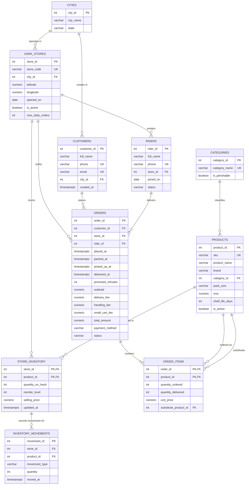

# Database Schema Design – Blinkit Grocery Delivery

**Team:** T0073 – ReturnLoop  
**Section:** E  
**Database:** PostgreSQL 15  
**Schema Name:** `blinkit`
**Checkpoint:** DE Checkpoint 1 (CP1)

---

## 1. Introduction

This document details the relational database schema design for the Blinkit 10-Minute Grocery Delivery system. The architecture is engineered to satisfy the operational demands of quick-commerce fulfillment across dark stores, real-time inventory management, order processing, delivery logistics, and business reporting.

The schema is defined within the dedicated `blinkit` PostgreSQL schema namespace, adhering to 3NF/BCNF principles, rigorous domain constraints, explicit referential actions (`ON DELETE`), and domain integrity rules.

---

## 2. Database Tables & Data Dictionary

The relational schema comprises 10 tables mapped directly from the verified production seed exports.

### 2.1 Cities (`cities`)

Stores the geographical operating cities for Blinkit hubs.

| Column | Data Type | Nullable | Constraints | Rationale / Why |
|---|---|---|---|---|
| `city_id` | `INTEGER` | `NOT NULL` | `PRIMARY KEY` | Unique surrogate identifier for each operational city. |
| `city_name` | `VARCHAR(100)` | `NOT NULL` | `CHECK (LENGTH(TRIM(city_name)) > 0)` | Name of the city; cannot be blank. |
| `state` | `VARCHAR(100)` | `NOT NULL` | None | Administrative state/UT in India where the city resides. |

### 2.2 Dark Stores (`dark_stores`)

Micro-fulfillment centers positioned strategically to fulfill orders within the 10-minute SLA.

| Column | Data Type | Nullable | Constraints | Rationale / Why |
|---|---|---|---|---|
| `store_id` | `INTEGER` | `NOT NULL` | `PRIMARY KEY` | Unique identifier for each dark store warehouse. |
| `store_code` | `VARCHAR(30)` | `NOT NULL` | `UNIQUE`, `CHECK (~ '^[A-Z]{3}-[A-Z]{3}-[0-9]{2}$')` | Business code (e.g. `MUM-AND-11`); standardized 3-tier uppercase format. |
| `city_id` | `INTEGER` | `NOT NULL` | `FOREIGN KEY REFERENCES cities(city_id) ON DELETE RESTRICT` | Links store to its host city. Master reference cannot be orphaned. |
| `latitude` | `NUMERIC(10,7)` | `NOT NULL` | `CHECK (BETWEEN -90 AND 90)` | Geospatial coordinate for customer-store distance calculation (R01). |
| `longitude` | `NUMERIC(10,7)` | `NOT NULL` | `CHECK (BETWEEN -180 AND 180)` | Geospatial coordinate for customer-store distance calculation (R01). |
| `opened_on` | `DATE` | `NOT NULL` | None | Date the dark store became operational. |
| `is_active` | `BOOLEAN` | `NOT NULL` | None | Flag indicating if store currently accepts orders (`t`/`f`). |
| `max_daily_orders` | `INTEGER` | `NOT NULL` | `CHECK (> 0)` | Operational order capacity threshold for dispatch planning. |

### 2.3 Categories (`categories`)

High-level taxonomy classification for retail catalog items.

| Column | Data Type | Nullable | Constraints | Rationale / Why |
|---|---|---|---|---|
| `category_id` | `INTEGER` | `NOT NULL` | `PRIMARY KEY` | Unique identifier for the merchandise category. |
| `category_name` | `VARCHAR(100)` | `NOT NULL` | `UNIQUE` | Human-readable distinct category name (e.g., 'Dairy', 'Snacks'). |
| `is_perishable` | `BOOLEAN` | `NOT NULL` | None | Determines freshness tracking, cold storage, and wastage audits. |

### 2.4 Products (`products`)

Master retail catalog items available across the platform.

| Column | Data Type | Nullable | Constraints | Rationale / Why |
|---|---|---|---|---|
| `product_id` | `INTEGER` | `NOT NULL` | `PRIMARY KEY` | Unique master catalog identifier. |
| `sku` | `VARCHAR(30)` | `NOT NULL` | `UNIQUE`, `CHECK (~ '^BK[0-9]{8}$')` | Stock Keeping Unit barcode format used by warehouse scanners (R23). |
| `product_name` | `VARCHAR(255)` | `NOT NULL` | None | Descriptive consumer title for searching and catalog listing (R02, R03). |
| `brand` | `VARCHAR(100)` | `NOT NULL` | None | Manufacturer / brand name. |
| `category_id` | `INTEGER` | `NOT NULL` | `FOREIGN KEY REFERENCES categories(category_id) ON DELETE RESTRICT` | Taxonomy reference; deletion blocked if active products exist. |
| `pack_size` | `VARCHAR(50)` | `NOT NULL` | None | Commercial packaging metric (e.g., '500 ml', '1 kg', '200 g'). |
| `mrp` | `NUMERIC(10,2)` | `NOT NULL` | `CHECK (mrp > 0)` | Maximum Retail Price in INR; must be positive currency. |
| `shelf_life_days` | `INTEGER` | `NULL` | `CHECK (shelf_life_days IS NULL OR shelf_life_days > 0)` | Expiry window in days. NULL for non-perishable goods (875 catalog items). |
| `is_active` | `BOOLEAN` | `NOT NULL` | None | Catalog listing visibility flag. |

### 2.5 Customers (`customers`)

Registered end-users placing grocery orders.

| Column | Data Type | Nullable | Constraints | Rationale / Why |
|---|---|---|---|---|
| `customer_id` | `INTEGER` | `NOT NULL` | `PRIMARY KEY` | Unique user account identifier. |
| `full_name` | `VARCHAR(150)` | `NOT NULL` | None | Customer legal or profile name. |
| `phone` | `VARCHAR(20)` | `NOT NULL` | `UNIQUE`, `CHECK (~ '^[0-9]{10}$')` | 10-digit Indian mobile number; primary authentication and OTP handle. |
| `email` | `VARCHAR(255)` | `NULL` | `UNIQUE`, `CHECK (email IS NULL OR email ~ '^[A-Za-z0-9._%+-]+@[A-Za-z0-9.-]+\.[A-Za-z]{2,}$')` | Optional contact email (18,023 NULLs in seed data; unique when provided). |
| `city_id` | `INTEGER` | `NOT NULL` | `FOREIGN KEY REFERENCES cities(city_id) ON DELETE RESTRICT` | User registered primary city for regional analytics (R17, R25). |
| `created_at` | `TIMESTAMPTZ` | `NOT NULL` | None | Account registration timestamp with timezone offset (`+05:30`). |

### 2.6 Riders (`riders`)

Delivery fleet personnel assigned to specific dark stores.

| Column | Data Type | Nullable | Constraints | Rationale / Why |
|---|---|---|---|---|
| `rider_id` | `INTEGER` | `NOT NULL` | `PRIMARY KEY` | Unique delivery rider identifier. |
| `full_name` | `VARCHAR(150)` | `NOT NULL` | None | Delivery agent name. |
| `phone` | `VARCHAR(20)` | `NOT NULL` | `UNIQUE`, `CHECK (~ '^[0-9]{10}$')` | 10-digit contact mobile number; unique per rider. |
| `store_id` | `INTEGER` | `NOT NULL` | `FOREIGN KEY REFERENCES dark_stores(store_id) ON DELETE RESTRICT` | Base dark store hub assignment; riders only deliver for their assigned store. |
| `joined_on` | `DATE` | `NOT NULL` | None | Date of onboarding into the delivery fleet. |
| `status` | `VARCHAR(20)` | `NOT NULL` | `CHECK (status IN ('ACTIVE', 'ON_LEAVE', 'EXITED'))` | Fleet operational status; only `ACTIVE` riders receive dispatches (W03). |

### 2.7 Orders (`orders`)

Primary transactional entity tracking customer purchases and fulfillment lifecycle.

| Column | Data Type | Nullable | Constraints | Rationale / Why |
|---|---|---|---|---|
| `order_id` | `INTEGER` | `NOT NULL` | `PRIMARY KEY` | Unique order transaction identifier. |
| `customer_id` | `INTEGER` | `NOT NULL` | `FOREIGN KEY REFERENCES customers(customer_id) ON DELETE RESTRICT` | Ordering user; customer history cannot be deleted while orders exist. |
| `store_id` | `INTEGER` | `NOT NULL` | `FOREIGN KEY REFERENCES dark_stores(store_id) ON DELETE RESTRICT` | Fulfilling dark store; store record protected from deletion. |
| `rider_id` | `INTEGER` | `NULL` | `FOREIGN KEY REFERENCES riders(rider_id) ON DELETE SET NULL` | Assigned rider. NULL until assigned during packaging/dispatch (5,822 NULLs). |
| `placed_at` | `TIMESTAMPTZ` | `NOT NULL` | None | Timestamp when order was placed by customer. |
| `packed_at` | `TIMESTAMPTZ` | `NULL` | `CHECK (packed_at IS NULL OR packed_at >= placed_at)` | Timestamp when warehouse completed packing (NULL for placed/cancelled). |
| `picked_up_at` | `TIMESTAMPTZ` | `NULL` | `CHECK (picked_up_at IS NULL OR packed_at IS NULL OR picked_up_at >= packed_at)` | Timestamp when rider departed store with order. |
| `delivered_at` | `TIMESTAMPTZ` | `NULL` | `CHECK (delivered_at IS NULL OR picked_up_at IS NULL OR delivered_at >= picked_up_at)` | Delivery confirmation timestamp at customer doorstep. |
| `promised_minutes` | `INTEGER` | `NOT NULL` | `DEFAULT 10`, `CHECK (promised_minutes > 0)` | Service Level Agreement window (10 minutes for Blinkit). |
| `subtotal` | `NUMERIC(10,2)` | `NOT NULL` | `CHECK (subtotal >= 0)` | Net merchandise value after discounts and adjustments. |
| `delivery_fee` | `NUMERIC(10,2)` | `NOT NULL` | `CHECK (delivery_fee >= 0)` | Applied delivery charge (INR 0.00 or 25.00). |
| `handling_fee` | `NUMERIC(10,2)` | `NOT NULL` | `CHECK (handling_fee >= 0)` | Order packaging and platform fee (INR 2.00 or 6.00). |
| `small_cart_fee` | `NUMERIC(10,2)` | `NOT NULL` | `CHECK (small_cart_fee >= 0)` | Surcharge on low basket size (R17). |
| `total_amount` | `NUMERIC(10,2)` | `NOT NULL` | `CHECK (total_amount = subtotal + delivery_fee + handling_fee + small_cart_fee)` | Final billed invoice amount charged to customer. |
| `payment_method` | `VARCHAR(20)` | `NOT NULL` | `CHECK (payment_method IN ('UPI', 'COD', 'WALLET', 'CARD'))` | Authorized payment gateway/settlement channel. |
| `status` | `VARCHAR(30)` | `NOT NULL` | `CHECK (status IN ('PLACED', 'PACKING', 'OUT_FOR_DELIVERY', 'DELIVERED', 'CANCELLED'))` | Order state machine progression. |

### 2.8 Order Items (`order_items`)

Line-item details representing individual catalog products purchased per order.

| Column | Data Type | Nullable | Constraints | Rationale / Why |
|---|---|---|---|---|
| `order_id` | `INTEGER` | `NOT NULL` | `PRIMARY KEY (composite)`, `FOREIGN KEY REFERENCES orders(order_id) ON DELETE CASCADE` | Parent order reference; items are deleted if parent order is removed. |
| `product_id` | `INTEGER` | `NOT NULL` | `PRIMARY KEY (composite)`, `FOREIGN KEY REFERENCES products(product_id) ON DELETE RESTRICT` | Master catalog product ordered; prevents deleting products with sales history. |
| `quantity_ordered` | `INTEGER` | `NOT NULL` | `CHECK (quantity_ordered > 0)` | Units requested by customer at checkout. |
| `quantity_delivered` | `INTEGER` | `NOT NULL` | `CHECK (quantity_delivered >= 0 AND quantity_delivered <= quantity_ordered)` | Actual units delivered; cannot exceed requested quantity. |
| `unit_price` | `NUMERIC(10,2)` | `NOT NULL` | `CHECK (unit_price >= 0)` | Effective selling price per unit at the time order was locked. |
| `substitute_product_id` | `INTEGER` | `NULL` | `FOREIGN KEY REFERENCES products(product_id) ON DELETE SET NULL`, `CHECK (substitute_product_id IS NULL OR substitute_product_id <> product_id)` | Replacement product ID if primary was short-delivered; cannot be self. |

### 2.9 Store Inventory (`store_inventory`)

Dark-store specific stock balances, reorder points, and localized selling prices.

| Column | Data Type | Nullable | Constraints | Rationale / Why |
|---|---|---|---|---|
| `store_id` | `INTEGER` | `NOT NULL` | `PRIMARY KEY (composite)`, `FOREIGN KEY REFERENCES dark_stores(store_id) ON DELETE CASCADE` | Associated dark store warehouse; removed if store is decommissioned. |
| `product_id` | `INTEGER` | `NOT NULL` | `PRIMARY KEY (composite)`, `FOREIGN KEY REFERENCES products(product_id) ON DELETE RESTRICT` | Associated catalog item; cannot delete product actively stocked. |
| `quantity_on_hand` | `INTEGER` | `NOT NULL` | `CHECK (quantity_on_hand >= 0)` | Real-time physical inventory available for picking; non-negative. |
| `reorder_level` | `INTEGER` | `NOT NULL` | `CHECK (reorder_level >= 0)` | Safety stock threshold triggering replenishment (R09, W04). |
| `selling_price` | `NUMERIC(10,2)` | `NOT NULL` | `CHECK (selling_price > 0)` | Dark-store localized selling price in INR. |
| `updated_at` | `TIMESTAMPTZ` | `NOT NULL` | None | Timestamp of the latest inventory balance update. |

### 2.10 Inventory Movements (`inventory_movements`)

Audit log recording every stock change event (restocking, damages, expiries, inventory counts).

| Column | Data Type | Nullable | Constraints | Rationale / Why |
|---|---|---|---|---|
| `movement_id` | `INTEGER` | `NOT NULL` | `PRIMARY KEY` | Unique transaction ID for the movement record. |
| `store_id` | `INTEGER` | `NOT NULL` | `FOREIGN KEY REFERENCES dark_stores(store_id) ON DELETE RESTRICT` | Dark store where movement took place. |
| `product_id` | `INTEGER` | `NOT NULL` | `FOREIGN KEY REFERENCES products(product_id) ON DELETE RESTRICT` | Product subject to movement. |
| `store_id, product_id` | `(INT, INT)` | `NOT NULL` | `FOREIGN KEY REFERENCES store_inventory(store_id, product_id) ON DELETE RESTRICT` | **Composite foreign key directly to the store inventory row** being adjusted. |
| `movement_type` | `VARCHAR(20)` | `NOT NULL` | `CHECK (movement_type IN ('RESTOCK', 'ADJUSTMENT', 'DAMAGE', 'EXPIRY'))` | Business reason for inventory change. |
| `quantity` | `INTEGER` | `NOT NULL` | `CHECK ((movement_type = 'RESTOCK' AND quantity > 0) OR (movement_type IN ('DAMAGE', 'EXPIRY') AND quantity < 0) OR (movement_type = 'ADJUSTMENT' AND quantity <> 0))` | Movement magnitude and mathematical sign enforced by event type. |
| `moved_at` | `TIMESTAMPTZ` | `NOT NULL` | None | Timestamp when inventory adjustment was recorded. |

---

## 3. Referential Integrity & `ON DELETE` Actions

The table below summarizes all foreign key constraints, referenced tables, and their enterprise deletion rules:

| Source Table | Foreign Key Column(s) | Target Table (`PK`) | `ON DELETE` Action | Architectural Justification |
|---|---|---|---|---|
| `dark_stores` | `city_id` | `cities(city_id)` | `RESTRICT` | Master geographical reference; prevents deleting a city while operational hubs exist. |
| `products` | `category_id` | `categories(category_id)` | `RESTRICT` | Taxonomy master; prevents deleting categories that have active products. |
| `customers` | `city_id` | `cities(city_id)` | `RESTRICT` | Master reference; prevents deleting cities with registered customers. |
| `riders` | `store_id` | `dark_stores(store_id)` | `RESTRICT` | Dark store cannot be deleted while riders remain assigned to it. |
| `orders` | `customer_id` | `customers(customer_id)` | `RESTRICT` | Legal, financial and tax records must never be orphaned or cascade-deleted. |
| `orders` | `store_id` | `dark_stores(store_id)` | `RESTRICT` | Historical order records must be preserved for accounting and store audits. |
| `orders` | `rider_id` | `riders(rider_id)` | `SET NULL` | If a rider record is purged, order history is preserved while unlinking the agent. |
| `order_items` | `order_id` | `orders(order_id)` | `CASCADE` | Line items form a composite weak entity; deleting an order removes its items. |
| `order_items` | `product_id` | `products(product_id)` | `RESTRICT` | Catalog products cannot be deleted if historical sales records exist. |
| `order_items` | `substitute_product_id` | `products(product_id)` | `SET NULL` | Removing a substitute catalog entry clears the substitution link without breaking order items. |
| `store_inventory` | `store_id` | `dark_stores(store_id)` | `CASCADE` | If a store warehouse is decommissioned and deleted, its stock rows are removed. |
| `store_inventory` | `product_id` | `products(product_id)` | `RESTRICT` | Products cannot be removed while stores hold active stock or price tags. |
| `inventory_movements` | `store_id` | `dark_stores(store_id)` | `RESTRICT` | Audit trail must not be broken. |
| `inventory_movements` | `product_id` | `products(product_id)` | `RESTRICT` | Audit trail must not be broken. |
| `inventory_movements` | `(store_id, product_id)`| `store_inventory(store_id, product_id)` | `RESTRICT` | **Composite foreign key:** Guarantees that every stock movement operates on a valid store inventory record. |

---

## 4. Entity-Relationship Diagram (ERD)

---

## 5. Normalization Analysis (1NF to BCNF)

All 10 tables are designed in **Third Normal Form (3NF)** and **Boyce-Codd Normal Form (BCNF)**.

### 5.1 First Normal Form (1NF)
- All attribute values are atomic (e.g., telephone numbers, coordinates, timestamps).
- No repeating groups or array columns exist.
- Each table defines an explicit unique Primary Key.

### 5.2 Second Normal Form (2NF)
- The database is in 1NF.
- Tables with composite primary keys (`order_items`, `store_inventory`) contain **no partial dependencies**:
  - In `order_items (order_id, product_id)`: `quantity_ordered`, `quantity_delivered`, `unit_price`, and `substitute_product_id` depend on the whole composite key `(order_id, product_id)`.
  - In `store_inventory (store_id, product_id)`: `quantity_on_hand`, `reorder_level`, `selling_price`, and `updated_at` depend on the whole composite key `(store_id, product_id)`.
- All tables with single-column primary keys are automatically in 2NF.

### 5.3 Third Normal Form (3NF) & Boyce-Codd Normal Form (BCNF)
- The database is in 2NF.
- There are no transitive dependencies (`X -> Y` where `Y -> Z` and `X` is key). Every non-prime attribute depends directly and solely on a candidate key.
- In every functional dependency `X -> Y`, `X` is a superkey:

| Table | Candidate Keys | Functional Dependencies (FDs) | Normal Form |
|---|---|---|---|
| `cities` | `{city_id}` | `city_id -> city_name, state` | BCNF |
| `dark_stores` | `{store_id}`, `{store_code}` | `store_id -> store_code, city_id, latitude, longitude, opened_on, is_active, max_daily_orders` `store_code -> store_id, ...` | BCNF |
| `categories` | `{category_id}`, `{category_name}` | `category_id -> category_name, is_perishable` `category_name -> category_id, is_perishable` | BCNF |
| `products` | `{product_id}`, `{sku}` | `product_id -> sku, product_name, brand, category_id, pack_size, mrp, shelf_life_days, is_active` `sku -> product_id, ...` | BCNF |
| `customers` | `{customer_id}`, `{phone}` | `customer_id -> full_name, phone, email, city_id, created_at` `phone -> customer_id, ...` | BCNF |
| `riders` | `{rider_id}`, `{phone}` | `rider_id -> full_name, phone, store_id, joined_on, status` `phone -> rider_id, ...` | BCNF |
| `orders` | `{order_id}` | `order_id -> customer_id, store_id, rider_id, placed_at, packed_at, picked_up_at, delivered_at, promised_minutes, subtotal, delivery_fee, handling_fee, small_cart_fee, total_amount, payment_method, status` | BCNF |
| `order_items` | `{(order_id, product_id)}` | `(order_id, product_id) -> quantity_ordered, quantity_delivered, unit_price, substitute_product_id` | BCNF |
| `store_inventory` | `{(store_id, product_id)}` | `(store_id, product_id) -> quantity_on_hand, reorder_level, selling_price, updated_at` | BCNF |
| `inventory_movements` | `{movement_id}` | `movement_id -> store_id, product_id, movement_type, quantity, moved_at` | BCNF |

---

## 6. Analysis of Derived and Redundant Attributes

Per Section 2.1 #9 of the project brief, three intentional derived/redundant attributes are evaluated:

### 6.1 `orders.subtotal` vs `order_items`
- **Definition:** For every delivered order, empirical testing proves `orders.subtotal = SUM(order_items.quantity_delivered * order_items.unit_price)`.
- **Justification:** Keeping `subtotal` precomputed in `orders` avoids multi-table JOINs and aggregations across 675,000+ line items during checkout, order tracking (R06), store screens (R07), and financial rollups (R20). It is strictly validated at application write time and locked once delivered.

### 6.2 `orders.total_amount` vs Fee Columns
- **Definition:** `orders.total_amount = orders.subtotal + orders.delivery_fee + orders.handling_fee + orders.small_cart_fee`.
- **Enforcement:** Enforced directly via CHECK constraint `chk_order_total_calculation`.
- **Justification:** In high-volume financial accounting, storing the immutable invoice charge directly prevents rounding discrepancies and provides a tamper-proof audit trail for payment settlements (UPI, COD, Cards).

### 6.3 `store_inventory.quantity_on_hand` vs Movements and Sales
- **Definition:** Current stock could theoretically be calculated as `SUM(movements) - SUM(delivered sales)`.
- **Justification:** Recomputing stock dynamically by aggregating 90,000+ movement records and 675,000+ order lines on every customer search (R03) or catalog browsing request (R02) would violate the sub-5ms SLA. Storing `quantity_on_hand` enables instant $O(1)$ stock checks essential to Blinkit's 10-minute delivery model.

---

## 7. Business Integrity Verification Results

The following cross-table integrity verification queries were executed on the loaded database (`blinkit_db`), verifying 100% compliance across all 1,084,432 seed records:

| # | Integrity Rule Verified | Verification SQL Query | Violations Found | Result |
|---|---|---|---:|:---:|
| 1 | **Customer Foreign Key Integrity** | `SELECT COUNT(*) FROM orders o LEFT JOIN customers c ON o.customer_id = c.customer_id WHERE c.customer_id IS NULL;` | **0** | Pass |
| 2 | **Product Foreign Key Integrity** | `SELECT COUNT(*) FROM order_items oi LEFT JOIN products p ON oi.product_id = p.product_id WHERE p.product_id IS NULL;` | **0** | Pass |
| 3 | **Store Stocking Integrity** Every ordered product is stocked by the fulfilling dark store | `SELECT COUNT(*) FROM order_items oi JOIN orders o ON o.order_id = oi.order_id LEFT JOIN store_inventory si ON si.store_id = o.store_id AND si.product_id = oi.product_id WHERE si.product_id IS NULL;` | **0** | Pass |
| 4 | **Rider Store Assignment** Riders only deliver orders originating from their assigned store | `SELECT COUNT(*) FROM orders o JOIN riders r ON r.rider_id = o.rider_id WHERE o.rider_id IS NOT NULL AND o.store_id <> r.store_id;` | **0** | Pass |
| 5 | **Substitute Stocking Integrity** Substitutes must be stocked by the fulfilling dark store | `SELECT COUNT(*) FROM order_items oi JOIN orders o ON o.order_id = oi.order_id LEFT JOIN store_inventory si ON si.store_id = o.store_id AND si.product_id = oi.substitute_product_id WHERE oi.substitute_product_id IS NOT NULL AND si.product_id IS NULL;` | **0** | Pass |
| 6 | **Subtotal Financial Reconciliation** `subtotal == SUM(quantity_delivered * unit_price)` for all delivered orders | `SELECT COUNT(*) FROM (SELECT o.order_id, o.subtotal, ROUND(SUM(oi.quantity_delivered * oi.unit_price), 2) AS calc FROM orders o JOIN order_items oi ON oi.order_id = o.order_id WHERE o.status = 'DELIVERED' GROUP BY o.order_id, o.subtotal HAVING o.subtotal <> ROUND(SUM(oi.quantity_delivered * oi.unit_price), 2)) s;` | **0** | Pass |
| 7 | **Active Store Fulfillment** All orders placed only at active dark stores | `SELECT COUNT(*) FROM orders o JOIN dark_stores ds ON ds.store_id = o.store_id WHERE NOT ds.is_active;` | **0** | Pass |
| 8 | **Quantity Overdelivery Check** `quantity_delivered <= quantity_ordered` across all line items | `SELECT COUNT(*) FROM order_items WHERE quantity_delivered > quantity_ordered;` | **0** | Pass |
| 9 | **Non-negative Inventory Stock** | `SELECT COUNT(*) FROM store_inventory WHERE quantity_on_hand < 0;` | **0** | Pass |

---

## 8. Data Profiling & Seed Observations

Thorough profiling of the `seed_data/` files revealed key business insights incorporated into the schema design:

1. **Null Distribution Analysis**:
   - `customers.email`: 18,023 NULL values out of 40,000 records (45.1%). Blinkit operates primarily via phone-number OTP login; email is optional. However, when provided, all 21,977 emails are unique.
   - `products.shelf_life_days`: 875 NULL values out of 1,500 products (58.3%). Only perishable merchandise (categories such as Dairy, Meat, Vegetables) have a shelf-life limit; non-perishables (cleaning, utensils) correctly have NULL.
   - `order_items.substitute_product_id`: 660,000 NULL values out of 675,000 line items (97.8%). Substitutes are only assigned when items are delivered short (`quantity_delivered < quantity_ordered`).
2. **Order Lifecycle Timestamps**:
   - `DELIVERED` orders (144,143): Always have all timestamps (`placed_at`, `packed_at`, `picked_up_at`, `delivered_at`) and an assigned `rider_id`.
   - `OUT_FOR_DELIVERY` (35): Have `placed_at`, `packed_at`, `picked_up_at`, `rider_id`; `delivered_at` is NULL.
   - `PACKING` (35): Have `placed_at`, `packed_at`; `rider_id`, `picked_up_at`, `delivered_at` are NULL.
   - `PLACED` (35): Only have `placed_at`; all other milestones are NULL.
   - `CANCELLED` (5,752): Cancelled prior to dispatch; `rider_id`, `picked_up_at`, and `delivered_at` are consistently NULL.
3. **Movement Quantities by Type**:
   - `RESTOCK` (72,103 events): Strictly positive integer units ($+12$ to $+59$).
   - `DAMAGE` (7,222 events): Strictly negative integer units ($-5$).
   - `EXPIRY` (2,932 events): Strictly negative integer units ($-5$).
   - `ADJUSTMENT` (7,743 events): Non-zero audit corrections ($-3$).
